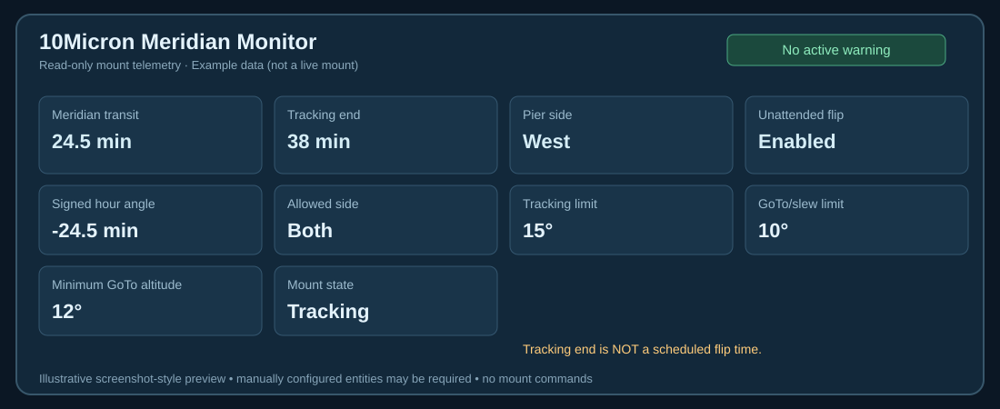

# 10Micron Mount Monitor for Home Assistant

## Documentation / Dokumentace

- 🇨🇿 **[Český uživatelský návod – instalace, konfigurace, UTC, refrakce, alarmy](docs/USER_GUIDE_CS.md)**
- 🇬🇧 **[English User Guide – installation, configuration, UTC, refraction, alarms](docs/USER_GUIDE_EN.md)**
- **[Alarm card and blueprints / Zvukový alarm a blueprinty](docs/ALARMS.md)**
- **[Versioned downloads / Stažení hotového ZIPu](https://github.com/Z0472/ha-10micron-mount/releases)**

Community-maintained **experimental** local TCP integration for 10Micron mounts. Based on a GM3000HPS / Control Box V3 installation; **other models and firmwares are not yet verified**. Not affiliated with 10Micron.

## Release status

**Experimental preview.** Real TCP telemetry has been tested on a GM3000HPS; the optional browser siren and automatic UTC/refraction writes have not yet completed end-to-end field testing. Use independent mount and roof safety protections. The public repository does **not** include private observatory automation code or its history.

## Features

- Tracking state, Gstat/GTRK watchdog, Alt/Az, mount refraction state, meridian and tracking-limit telemetry.
- Read-only PARK state and optional comparison with user-provided reference Alt/Az. **No mount movement or PARK commands** in this standalone edition.
- Optional mount UTC checks and UTC synchronization using user-configured NTP server(s).
- Optional refraction temperature/pressure preview, enable/disable, and verified updates from Home Assistant sensors.
- Optional automatic time sync after a qualified mount TCP offline → online transition (120 seconds offline, then 60 seconds stable online).
- Optional automatic refraction refresh upon connection and significant sensor changes.
- All native writes and all automatic operations are **OFF by default**.

## Integration icon

An original astronomy mount icon is included at `custom_components/tenmicron_mount/brand/icon.png`. Home Assistant 2026.3+ reads the icon directly from this location, including manual installations. The image does not use the 10Micron manufacturer's logo and does not imply an official integration.

After updating, restart HA Core and refresh the browser. Some HACS versions may still display a placeholder in the HACS catalog even though the icon works on the Home Assistant integrations/device pages.

## Optional alarms (v0.7.0)

The 10Micron integration does **not** play audio by itself. Optional components:

- **Browser sound card** in `www/tenmicron-alarm-card.js`: manual user activation, local beep/siren on fresh tracking-fault `off → on`, Test, Silence; cannot ring when the browser is sleeping or closed.
- **Tracking alarm blueprint** `blueprints/automation/tenmicron/tracking_stop_alarm.yaml`: user chooses the binary sensor and what happens (physical siren, phone alert, persistent notification).
- **Connection-loss blueprint** `blueprints/automation/tenmicron/connection_lost_alarm.yaml`: optional alert for sustained `unavailable` / `unknown` mount state. Deliberately powering off the mount can trigger it too.

See [Alarm instructions – English and Czech](docs/ALARMS.md) for exact manual installation and configuration. HACS installation of the Python integration does **not** automatically install the card or blueprints.

## What can I download? (integration, alarms and dashboards)

The [v0.7.3 pre-release](https://github.com/Z0472/ha-10micron-mount/releases/tag/v0.7.3) contains a versioned ZIP package and checksum file.

| Package component | Location in this repository | How to use it |
| --- | --- | --- |
| **Mount monitor integration** | [`custom_components/tenmicron_mount/`](custom_components/tenmicron_mount/) | Copy into `/config/custom_components/tenmicron_mount/`; restart HA Core. Main integration supports NTP UTC checks/sync and refraction pressure/temperature updates, with writes disabled by default. |
| **Meridian Monitor card** | [`www/tenmicron-meridian-card.js`](www/tenmicron-meridian-card.js) | Read-only English Lovelace telemetry for meridian, tracking end, pier side and unattended flip. Install separately under `/config/www/` using the [English guide](docs/USER_GUIDE_EN.md#2b-meridian-monitor-card). |
| **Optional dashboard alarm card** | [`www/tenmicron-alarm-card.js`](www/tenmicron-alarm-card.js) | Copy to `/config/www/`, register `/local/tenmicron-alarm-card.js?v=0.7.0` as a JavaScript module, then add the YAML card in [Alarm setup](docs/ALARMS.md). |
| **Tracking-stop automation blueprint** | [`blueprints/automation/tenmicron/tracking_stop_alarm.yaml`](blueprints/automation/tenmicron/tracking_stop_alarm.yaml) | Copy to `/config/blueprints/automation/tenmicron/`; configure notification or siren actions in HA. |
| **Connection-loss automation blueprint** | [`blueprints/automation/tenmicron/connection_lost_alarm.yaml`](blueprints/automation/tenmicron/connection_lost_alarm.yaml) | Same destination; configure a sustained unavailability alert. |
| **Complete observatory cockpit/dashboard** | **Not included** | The author's private observatory dashboards and mechanical roof controls are intentionally not distributed. The public repository includes **two optional standalone Lovelace cards** (alarm and meridian), not a complete observatory cockpit. |

**The browser alarm card and blueprints are optional and must be installed separately.** HACS installation of the integration alone does not deploy these extras. The alarm card requires an open, awake browser and explicit sound activation; it is not a guaranteed unattended safety alarm.

### Quick start for first-time users

1. Download the v0.7.3 ZIP from [Releases](https://github.com/Z0472/ha-10micron-mount/releases/tag/v0.7.3), or download the repository source ZIP.
2. Copy the complete `custom_components/tenmicron_mount` directory, including `translations/` and `brand/`, into `/config/custom_components/` and restart Home Assistant Core.
3. In **Settings → Devices & services → Add integration**, choose **10Micron Mount Monitor**. Enter the mount's IP and TCP port (normally 3492).
4. Confirm read-only mount state and Alt/Az telemetry. Then, if needed, configure **Enable clock functions** with NTP servers and/or **Enable refraction preview/control** with two real Home Assistant temperature and pressure sensors.
5. Test **Check mount clock (no changes)** and **Preview refraction update (no changes)**, as applicable. Leave **native writes** and **automatic operations** OFF until you have disabled all competing time/refraction writers and reviewed the complete [English User Guide](docs/USER_GUIDE_EN.md).
6. Optionally install the separate browser alarm card and automation blueprints by following [Alarm setup](docs/ALARMS.md). These are not required for the monitor.

**Safety distinction:** Unlike the author's private observatory implementation, this standalone public edition has no PARK, GoTo, roof, shutter or other movement commands. The optional PARK reference only compares reported Alt/Az against a reference.

## Optional Meridian Monitor dashboard card (read-only)



**[Preview the English Meridian Monitor](docs/images/meridian-monitor-example.svg)** · **[Preview the optional tracking alarm card](docs/images/tracking-alarm-example.svg)**

> These are **illustrative screenshots with example values**, not captures of live mount operation. The card itself reads live HA sensor states, never sends commands.

This repository also contains the optional **[10Micron Meridian Monitor](www/tenmicron-meridian-card.js)** Lovelace card for meridian-transit countdown, tracking-end estimate, pier side, unattended-flip enabled status, hour angle and limits. No flip, GoTo, PARK or roof commands are implemented.

**Manual installation:** Copy `www/tenmicron-meridian-card.js` to `/config/www/tenmicron-meridian-card.js`, register `/local/tenmicron-meridian-card.js?v=0.1.0` under HA **Settings → Dashboards → Resources** as a **JavaScript module**, then create a Manual card:

```yaml
type: custom:tenmicron-meridian-card
title: 10Micron Meridian Monitor
```

The card attempts to discover conventional English entity IDs. **Actual HA entity IDs may differ**, especially after reinstalling, renaming or using multiple mounts. If the display shows missing/unknown values, specify the IDs under `entities:` as described in the [English guide](docs/USER_GUIDE_EN.md#2b-meridian-monitor-card).

**Important:** `Estimated time to tracking end` may refer to a *horizon limit OR meridian limit*. It is **not** a scheduled meridian-flip time. The unattended flip sensor only reports whether that setting is enabled, not that a flip will execute.

## Manual installation (without HACS)

For a complete installation walkthrough, start with the [Czech guide](docs/USER_GUIDE_CS.md) or [English guide](docs/USER_GUIDE_EN.md).

1. Download this project's ZIP and extract it.
2. Copy the **entire folder** `custom_components/tenmicron_mount/` into HA: `/config/custom_components/tenmicron_mount/`.
3. Restart **Home Assistant Core** (not the mount).
4. Go to **Settings → Devices & services → Add integration → 10Micron Mount Monitor**.
5. Enter the **mount IP/host and TCP port** (default: **3492**). Other configuration is under **Configure**.
6. Leave time/refraction automatic writes disabled until all sources and safety gates have been configured.

Back up an existing integration directory before any manual update. This standalone edition intentionally **does not implement PARK commands**. Do **not** install over a private observatory build that needs those commands.

## PARK reference and entity translations

Reference PARK altitude (Alt), azimuth (Az), and tolerance are optional and now shown immediately below the TCP connection settings. They are used **only** to validate the reported parked position; no movement commands are sent.

Entity names for sensors, binary sensors and buttons are translated into Czech and English. Stable entity unique IDs and all raw telemetry values are preserved; names of existing entities may be cached or customized in Home Assistant.

## Optional functions and their prerequisites

| Parameter | Required for | If missing |
| --- | --- | --- |
| Mount IP/host and port | All | Setup rejected |
| NTP servers (1–8, comma separated) | Time feature | Time feature cannot be enabled |
| `sensor.…` temperature entity | Refraction | Refraction cannot be enabled |
| `sensor.…` pressure entity | Refraction | Refraction cannot be enabled |
| Enable time feature | Manual clock check and UTC sync | Off by default |
| Enable refraction feature | Preview, enable, disable, update | Off by default |
| Native write commands | Manual/automatic writes | Off by default |
| Confirm legacy writers disabled | Manual/automatic writes | Required before writes |
| Auto time sync / auto refraction | Automatic writes | Off by default |

Configured refraction sensors must exist in HA when the feature is enabled. Readings must be fresh and valid at the moment of each update; acceptable units are °C/°F and hPa/mbar/Pa. No external weather service is queried. NTP servers are queried using UDP 123 from the HA host, and failure blocks clock actions.

Time synchronization checks are offered only when valid NTP servers have been configured. Native controls and automatic update require separate explicit opt-in.

## Safety

- **No movement, slew/GoTo, roof/shutter or PARK command** is provided by this public edition.
- Monitoring alarms and park geometry **are not independent safety interlocks** for roof motion.
- Restrict the mount's TCP service to trusted LAN devices; do not expose it to the Internet.
- Never run independent mount UTC/refraction writers at the same time.
- Mount offline, invalid TCP responses, stale weather sensors or NTP failures must not be interpreted as safe telemetry.

## HACS / Marketplace

The standalone directory layout `custom_components/tenmicron_mount/` is suitable for manual copying and HACS-compatible repository packaging. This integration is shared as an **experimental pre-release**. Versioned installation ZIPs are available in **GitHub Releases**, and manual copying into `custom_components/` is supported. HACS custom-repository installation may be used after validation; official HACS catalog listing is not yet claimed.

## Compatibility

Development baseline: **10Micron GM3000HPS, Control Box V3, firmware 3.4.0**. Other models and firmware variants are not yet field-verified.

License: MIT. Integration domain: `tenmicron_mount`.
