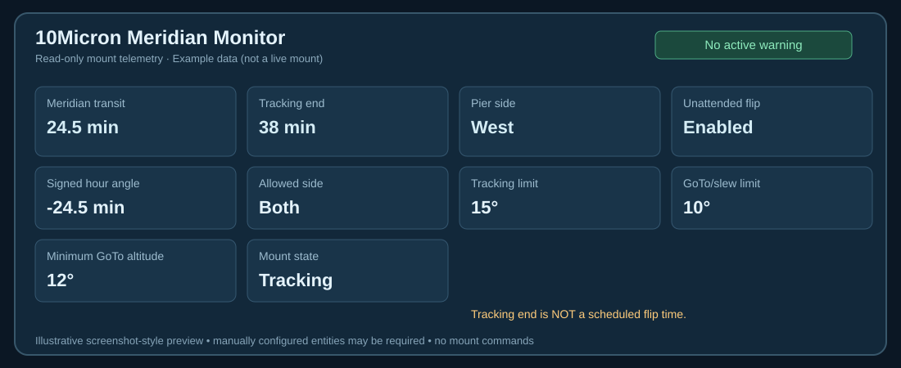

# 10Micron Mount Monitor – Uživatelský návod (CZ)

**Verze 0.7.3 – experimentální integrace pro Home Assistant.**
Vývoj a reálná komunikace ověřena s GM3000HPS, Control Box V3, FW 3.4.0.
Jde o komunitní integraci bez vazby na výrobce 10Micron. Nejde o bezpečnostní interlock.

## 1. Co umí

- Čte TCP telemetrii montáže: Gstat/GTRK, Alt/Az, tracking, PARK, tlak/teplotu refrakce, hodinový úhel a limity meridiánu.
- Hlídá neočekávané zastavení trackingu a delší přejezdy/dithering.
- Volitelně kontroluje a synchronizuje UTC podle NTP.
- Volitelně aktualizuje tlak a teplotu refrakce ze senzorů Home Assistanta.
- Volitelně ověřuje parkovací polohu proti referenční Alt/Az, ale **neposílá PARK ani GoTo**.
- Umožňuje přidat samostatnou kartu se zvukovým alarmem a automatizační blueprinty.

**Ve výchozím stavu integrace jen monitoruje; všechny automatické zápisy jsou vypnuté.**

## 2. Instalace

1. Stáhni kompletní ZIP z [GitHub Releases](https://github.com/Z0472/ha-10micron-mount/releases).
2. Zkopíruj celý adresář `custom_components/tenmicron_mount/` do `/config/custom_components/tenmicron_mount/`, včetně `translations/` a `brand/`.
3. Restartuj Home Assistant Core (nikoliv montáž).
4. V Nastavení → Zařízení a služby → Přidat integraci vyber **10Micron Mount Monitor**.
5. Zadej IP/host montáže a TCP port (výchozí **3492**). Pro první test ponech všechny zápisy vypnuté.

Před aktualizací zazálohuj dosavadní adresář integrace a nahraď jeho obsah.
Stejná struktura umožňuje ruční instalaci i vlastní HACS repozitář.
**Alarmovou kartu a blueprinty je potřeba instalovat zvlášť.**

## 2A. Volitelná karta do nástěnky a alarmy

Veřejný balíček obsahuje **jednu doplňkovou kartu do Lovelace**: [`www/tenmicron-alarm-card.js`](../www/tenmicron-alarm-card.js), která umí přehrávat zvukový alarm při neočekávaném zastavení sledování. **Neobsahuje kompletní grafický kokpit soukromé observatoře.** Senzory integrace lze zobrazit v libovolném vlastním dashboardu.

Kartu zkopíruj do `/config/www/`, v Nastavení → Nástěnky → Zdroje přidej JavaScript modul `/local/tenmicron-alarm-card.js?v=0.7.0` a použij konfiguraci z [návodu k alarmům](ALARMS.md). Pro automatické notifikace jsou dostupné dva samostatně instalované [blueprinty](../blueprints/automation/tenmicron/). Po instalaci samotné integrace přes HACS se tyto doplňky nepřidávají automaticky.

## 2B. Karta Meridian Monitor (pouze pro čtení)



**Obrázek je ukázkové zobrazení s fiktivními hodnotami, nikoli snímek živé montáže.**

Veřejný projekt obsahuje také `www/tenmicron-meridian-card.js`, samostatnou **anglickou** Lovelace kartu zobrazující čas do průchodu meridiánem, odhad konce sledování, stranu pilíře, stav povolení unattended flipu, hodinový úhel a limity. Karta nic neovládá.

1. Zkopíruj `www/tenmicron-meridian-card.js` do `/config/www/`.
2. V **Nastavení → Nástěnky → Zdroje** přidej JavaScript modul `/local/tenmicron-meridian-card.js?v=0.1.0`.
3. Přidej ruční kartu:

```yaml
type: custom:tenmicron-meridian-card
title: 10Micron Meridian Monitor
```

Pokud nejsou automaticky rozpoznané názvy entit, je nutné doplnit skutečné ID senzorů pomocí `entities:` podle [anglického návodu](USER_GUIDE_EN.md#2b-meridian-monitor-card). Identifikátory mohou být po přeinstalaci jiné.

**Pozor:** Odhad konce sledování **není** předpovědí času meridiánového flipu. Může jít o horizontální či meridiánový limit. Hodnota unattended flip znamená pouze informaci o povolení této funkce v montáži.

## 3. Konfigurace

| Nastavení | Význam |
|---|---|
| IP/host, port | TCP připojení k řídicí jednotce (obvykle 3492) |
| Interval | Čtení základní telemetrie, výchozí 10 s; meridiánové údaje nejvýše každých 60 s |
| TCP timeout | Výchozí 2 s |
| Referenční výška PARK, azimut PARK | Volitelné Alt/Az v úhlech; musí být zadány společně |
| Tolerance PARK | Výchozí 0,5° |
| NTP servery | 1–8 adres oddělených čárkou, např. `0.pool.ntp.org,1.pool.ntp.org` |
| Entita teploty | Existující `sensor.*` Home Assistanta |
| Entita tlaku | Existující `sensor.*` Home Assistanta |
| Povolit kontrolu/synchronizaci času | Zpřístupní časové funkce pouze s NTP |
| Povolit refrakci | Zpřístupní funkce pouze s oběma senzorovými entitami |
| Povolit nativní zápisy | Povolí ruční změny času/refrakce, ale vyžaduje též potvrzení vypnutí starých zapisovačů |
| Potvrzení vypnutí starých zapisovačů | Povinné před jakýmkoli zápisem |
| Automatická synchronizace času | Volitelná po splněném offline → online |
| Automatická aktualizace refrakce | Volitelná po připojení a při změně čidel |
| Tolerance přejezdu/ditheringu | Výchozí 60 s |

Bez NTP není možné aktivovat časové funkce. Bez **obou** existujících
entit teploty a tlaku nelze aktivovat refrakci. Hodnoty se navíc ověřují
při každém zápisu.

**PARK:** referenční Alt/Az slouží jen k porovnání polohy při Gstat=5.
Bez těchto souřadnic je senzor ověřené parkovací polohy neznámý.
Nejde o nezávislé potvrzení bezpečného zavření střechy.

## 4. Ruční kontrola a synchronizace času

**Kontrola hodin montáže (bez změn):** porovná čas montáže s NTP.
Montáž **nesynchronizuje**. Výsledek se objeví v oznámení HA pod zvonečkem
a v senzorech poslední kontroly (výsledek, čas, odchylka montáže v ms,
odchylka hodin HA proti NTP). Kladný offset montáže znamená, že je napřed.
Případná navržená korekce nebyla provedena.

**Synchronizovat UTC (NTP):** zapisuje do montáže a vyžaduje obě
potvrzení nativních zápisů. Chování podle zjištěného offsetu:

| Odchylka | Činnost |
|---|---|
| Pod 100 ms | Neprovádí korekci |
| 100–999 ms | Jemná korekce a kontrola |
| Nad 999 ms | Úplné nastavení UTC **pouze ve stavech Gstat 1, 5 nebo 7**, jinak odmítnutí |

Po zápisu se ověřuje reziduální odchylka s limitem 200 ms.
NTP komunikace vyžaduje dostupné servery na odchozím **UDP 123**.
Časové funkce se nesmějí používat souběžně s jiným zapisovačem hodin montáže.

## 5. Automatická synchronizace UTC – kdy přesně běží

Automatika je ve výchozím stavu **vypnutá**. Po explicitním povolení:

1. Integrace musí **pozorovat TCP offline minimálně 120 sekund**.
2. Následně musí zjistit skutečný přechod **offline → online**.
3. Počká **60 sekund stabilního online**.
4. Provede jednu kontrolu a případnou korekci podle výše uvedených limitů.
5. Krátký výpadek nebo obyčejné periodické čtení korekci znovu nespustí.

Restart HA, zatímco montáž už je online, **nespouští časovou synchronizaci**.
Automatika reaguje na pozorované TCP připojení, nikoli přímo na sepnutí
napájecího relé. Výsledek a historii posledních 12 pokusů ukládá
odděleně od ručních kontrol.

## 6. Ruční a automatická refrakce

Zadej **obě** entity: teplotu (°C či °F) a tlak (hPa/mbar/Pa).
Neplatné, `unknown`, `unavailable` a zastaralé hodnoty se nezapisují.

| Parametr | Rozsah a platnost |
|---|---|
| Teplota | −40 až +50 °C; nejvýše 60 minut od `last_updated` |
| Tlak | 850 až 1050 hPa; nejvýše 180 minut od `last_updated` |

Pozor: pro kontrolu stáří slouží čas aktualizace stavu entity v HA.
I konstantní hodnota může být po dlouhé době vyhodnocena jako zastaralá.

**Ruční tlačítka:**
- Náhled refrakce: žádný zápis.
- Zapnout refrakci: zapíše teplotu/tlak a zapne refrakci montáže.
- Vypnout refrakci: vypne její korekci.
- Aktualizovat teplotu/tlak: zapíše a zpětně ověří obě hodnoty;
  **samo nezapíná vypnutou refrakci**.

Automatika průběžně porovnává hodnoty proti **poslednímu úspěšnému
zápisu ověřenému zpětným čtením**, nikoli proti poslednímu měření:

| Podmínka | Činnost |
|---|---|
| Pozorovaný offline → online | Po 60 s stabilizace odešle obě hodnoty |
| Změna teploty ≥ **1,0 °C** | Odešle teplotu i tlak |
| Změna tlaku ≥ **2,0 hPa** | Odešle teplotu i tlak |
| Žádný práh překročen | Nic nezapisuje |

**Není zde povinný zápis každých 30 minut.** Při úspěchu se nové hodnoty
uloží jako referenční, při chybě zůstává starý základ.

**Známé omezení v0.7.1:** Pokud HA startuje s montáží již online,
počáteční zápis refrakce se **nevynucuje**. Nastane až po pozdějším
offline → online, ručním zápisu nebo při dosažení prahu oproti dříve
uloženému základu. Pokud žádný platný základ neexistuje, samotné
periodické čtení jej nevytvoří. Před úplně bezobslužným použitím
je nutné počáteční stav ověřit.

## 7. Watchdog, alarm, TCP

Gstat=5 (PARK) nevyhlašuje falešný alarm. Stav Gstat=6 (přejezd/dithering)
má toleranci (výchozí 60 s). Nečekané GTRK=0 a chybové stavy vyvolají
senzor neočekávaného STOP.

**Nedostupnost TCP není totéž co neočekávaný STOP** – hodnoty přejdou
do `unavailable`. Pro dlouhodobou nedostupnost existuje volitelný blueprint.

V Release ZIP je `www/tenmicron-alarm-card.js` s povolením zvuku, testem
a místním umlčením, dále blueprinty pro STOP a výpadek spojení.
Instalace: **[Podrobný návod na alarmy](ALARMS.md)**.
Prohlížeč musí být otevřený, odjištěný a neuspaný; karta není
nezávislou zabezpečovací sirénou.

## 8. Diagnostika a bezpečnost

| Projev | Co ověřit |
|---|---|
| Všechny entity nedostupné | IP, port, zapnutá montáž, firewall/VPN |
| Neaktivní tlačítka | Povolení funkce, NTP/čidla, dvě potvrzení pro zápis |
| Selhání NTP | Odchozí UDP 123, DNS, NTP servery, systémový čas HA |
| Bez výsledku kontroly času | Oznámení pod zvonečkem, senzory poslední kontroly |
| Refrakce se nemění | Platnost čidel, stav automatizace, poslední ověřený zápis a prahy |
| PARK ověření neznámé | Obě referenční souřadnice a stav Gstat=5 |
| Zvuk nehraje | Povolit zvuk, otevřená stránka a nová událost off → on |

Pro logování lze do `configuration.yaml` přidat:

```yaml
logger:
  logs:
    custom_components.tenmicron_mount: debug
```

**Nevystavuj řídicí TCP port montáže veřejnému internetu – použij LAN
nebo VPN.** Integrace není bezpečnostní interlock střechy či kolizí.
Změny času/refrakce nejprve ověř ručně a neměj více automatických
zapisovačů současně. Další modely a verze firmware nejsou ověřené.
