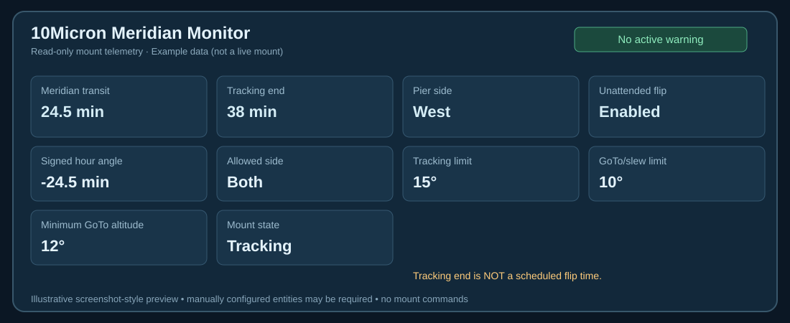

# 10Micron Mount Monitor – User Guide (EN)

**Version 0.7.2 – experimental Home Assistant integration.**
Development baseline: GM3000HPS, Control Box V3, firmware 3.4.0.
Unofficial community project, not affiliated with 10Micron and not a safety interlock.

## 1. Features

- Reads mount TCP status (Gstat/GTRK), Alt/Az, tracking, PARK, refraction
  pressure/temperature, hour angle, meridian and tracking limits.
- Detects unexpected tracking stop and prolonged slew/dither state.
- Optionally checks and synchronizes mount UTC using NTP.
- Optionally updates refraction temperature/pressure from HA sensors.
- Optionally compares PARK to reference Alt/Az; **does not send PARK/GoTo**.
- Optional browser alarm card and HA automation blueprints.

**All automatic writes are disabled by default.**

## 2. Installation

1. Download the complete ZIP from [GitHub Releases](https://github.com/Z0472/ha-10micron-mount/releases).
2. Copy the entire `custom_components/tenmicron_mount/` folder
   to `/config/custom_components/tenmicron_mount/`,
   including `translations/` and `brand/`.
3. Restart Home Assistant Core (not the mount).
4. In **Settings → Devices & services → Add integration**, select
   **10Micron Mount Monitor**.
5. Enter mount IP/host and TCP port (default **3492**). Test read-only
   telemetry before enabling write features.

Back up the old integration folder before upgrading. Manual copying
and a HACS custom integration repository use the same Python component layout.
**Browser card and blueprints are installed separately**.

## 2A. Optional Lovelace dashboard card and alarm blueprints

The download includes **one optional custom Lovelace card** for audible tracking alerts: [`www/tenmicron-alarm-card.js`](../www/tenmicron-alarm-card.js). It is **not** a complete 10Micron dashboard, and the author's private observatory cockpit is **not** published here. You may add the integration's sensor/binary-sensor entities to any standard HA dashboard.

To install the alarm card:

1. Copy `www/tenmicron-alarm-card.js` to `/config/www/tenmicron-alarm-card.js`. If `/config/www/` did not previously exist, restart HA Core.
2. Open **Settings → Dashboards → Resources** and add `/local/tenmicron-alarm-card.js?v=0.7.0` as a **JavaScript module**.
3. Add a **Manual** dashboard card with the following YAML, replacing the sample entity ID with the tracking-fault binary sensor from your integration:

```yaml
type: custom:tenmicron-alarm-card
entity: binary_sensor.10micron_mount_unexpected_tracking_stop
language: en
volume: 0.08
```

4. Click **Enable sound** and **Test 1 s** in the active browser. Audio is local to that browser and must be re-enabled following reload; an unattended/closed browser cannot be relied upon to ring.

For HA notifications or a physical siren, copy the two YAML blueprints from [`blueprints/automation/tenmicron/`](../blueprints/automation/tenmicron/) into `/config/blueprints/automation/tenmicron/`, reload automations and create an automation using the imported blueprint. See the [full Alarm Guide](ALARMS.md). **Neither blueprint moves the telescope.**

## 2B. Meridian Monitor card



**This visual is a simulated example, not a live telescope screenshot.** The actual card reads your mount telemetry via Home Assistant and **does not issue commands**.

The optional `www/tenmicron-meridian-card.js` shows remaining minutes to meridian transit (when still approaching), estimated minutes to tracking end, mount pier side, unattended-flip setting, hour angle, allowed side, meridian tracking/slew limits and minimum GoTo altitude. The alarm state distinguishes tracking-end warnings at 30 and 5 minutes from transit warnings.

1. Copy `www/tenmicron-meridian-card.js` to `/config/www/tenmicron-meridian-card.js`.
2. In HA **Settings → Dashboards → Resources**, add `/local/tenmicron-meridian-card.js?v=0.1.0` as a **JavaScript module**. If `/config/www/` was newly created, restart HA Core.
3. Create a **Manual** Lovelace card:

```yaml
type: custom:tenmicron-meridian-card
title: 10Micron Meridian Monitor
```

The default guesses use common English entity slugs, but actual entity IDs can vary between installations. The card displays a warning instead of inventing missing values. You may explicitly map each sensor in the card YAML, for example:

```yaml
type: custom:tenmicron-meridian-card
title: 10Micron Meridian Monitor
entities:
  transit: sensor.YOUR_ACTUAL_MERIDIAN_TRANSIT_ENTITY
  end: sensor.YOUR_ACTUAL_TRACKING_END_ENTITY
  pier: sensor.YOUR_ACTUAL_PIER_SIDE_ENTITY
  flip: binary_sensor.YOUR_ACTUAL_UNATTENDED_FLIP_ENTITY
  allowed: sensor.YOUR_ACTUAL_ALLOWED_SIDE_ENTITY
  angle: sensor.YOUR_ACTUAL_HOUR_ANGLE_ENTITY
  trackLimit: sensor.YOUR_ACTUAL_TRACK_LIMIT_ENTITY
  slewLimit: sensor.YOUR_ACTUAL_SLEW_LIMIT_ENTITY
  horizon: sensor.YOUR_ACTUAL_HORIZON_LIMIT_ENTITY
  state: sensor.YOUR_ACTUAL_MOUNT_STATE_ENTITY
  tracking: sensor.YOUR_ACTUAL_TRACKING_ACTIVE_ENTITY
  transitSoon: binary_sensor.YOUR_ACTUAL_TRANSIT_WARNING_ENTITY
  endSoon: binary_sensor.YOUR_ACTUAL_TRACK_END_WARNING_ENTITY
  endCritical: binary_sensor.YOUR_ACTUAL_TRACK_END_CRITICAL_ENTITY
```

Find the real IDs in **Settings → Devices & services → 10Micron Mount Monitor → Entities** or **Developer tools → States**, and replace every `YOUR_ACTUAL_...` placeholder.

**Meridian transit is not flip time.** The mount's tracking-end estimate can also be controlled by the horizon limit. APT/ASCOM may initiate a flip at another time. The enabled unattended-flip flag is only a reported setting; it does not guarantee a flip will occur. This dashboard is not a safety interlock.

## 3. Configuration

| Setting | Meaning |
|---|---|
| Host and TCP port | Mount connection, normally TCP 3492 |
| Polling interval | Main telemetry interval, default 10 s; meridian values update at most every 60 s |
| TCP timeout | Default 2 s |
| Reference PARK Alt/Az | Optional parked-position reference; both must be provided together |
| PARK tolerance | Default 0.5° |
| NTP servers | 1–8 comma-separated hosts, e.g. `0.pool.ntp.org,1.pool.ntp.org` |
| Temperature entity | Existing Home Assistant `sensor.*` |
| Pressure entity | Existing Home Assistant `sensor.*` |
| Enable clock functions | Requires NTP; enables read-only clock check and optional sync |
| Enable refraction | Requires both HA entities |
| Enable native writes | Required to change clock/refraction |
| Confirm legacy writers disabled | Also required before writing |
| Automatic UTC synchronization | Opt-in on qualified observed reconnect |
| Automatic refraction update | Opt-in on reconnect and sensor thresholds |
| Slew/dither grace | Default 60 seconds |

Clock functionality cannot be enabled without valid NTP hosts; refraction
functionality cannot be enabled without both HA sensor entities.
For PARK comparison, enter true saved position Alt and Az. The verified
PARK binary sensor is read-only and **not proof of physical roof clearance**.

## 4. Manual time operations

**Check mount clock (no changes)** compares the mount clock with NTP.
It **does not change mount time**. The result appears in the Home Assistant
notification bell and dedicated last-clock-check sensors (result, time,
mount offset and HA-to-NTP offset). A positive mount offset means the mount
clock is ahead. Suggested corrections in this dry run were not applied.

**Synchronize mount UTC (NTP)** requires explicit write opt-in AND confirmation
that no other automated writers are active.

| Measured offset | Behavior |
|---|---|
| Below 100 ms | No change |
| 100–999 ms | Fine correction and readback verification |
| Above 999 ms | Full UTC set **only** in Gstat 1, 5 or 7; otherwise rejected |

Final residual offset must be within 200 ms for a successful outcome.
The HA host must have outbound **UDP 123** access to NTP.

## 5. Automatic UTC synchronization

Default: **OFF**. With explicit opt-in:

1. The integration must **observe at least 120 seconds TCP offline**.
2. It then observes a real **offline → online** transition.
3. Waits for **60 seconds continuously stable online**.
4. Performs one clock check and possible correction.
5. Normal polling or shorter outages do not retrigger correction.

**Starting HA when the mount is already online does not trigger UTC sync.**
This is based on observed TCP availability, **not a direct power-relay event**.
Automatic results and the last 12 history records are stored separately
from manual clock checks.

## 6. Refraction update – manual and automatic

Configure both HA sensors: temperature (°C/°F) and pressure (hPa/mbar/Pa).
Unknown, unavailable or stale values block writes.

| Input | Accepted values and freshness |
|---|---|
| Temperature | −40 to +50 °C; HA `last_updated` no older than 60 minutes |
| Pressure | 850–1050 hPa; HA `last_updated` no older than 180 minutes |

Sensors reporting unchanged values may become stale under this check.

Manual actions:
- **Preview refraction update (no changes)**: no write.
- **Enable refraction**: writes both sensor values and enables refraction.
- **Disable refraction**: turns off the mount refraction correction.
- **Update refraction pressure/temperature**: writes both values,
  verifies readback, but **does not automatically enable refraction**.

Automatic updates compare values to the **last successfully written and
verified values**, not the previous measurement.

| Condition | Action |
|---|---|
| Observed offline → online | After 60 seconds stable online, writes both sensor values |
| Temperature changes by ≥ **1.0 °C** since last verified write | Writes both |
| Pressure changes by ≥ **2.0 hPa** since last verified write | Writes both |
| No threshold reached | No write |

There is **no mandatory periodic 30-minute write**.
Successful readback updates the stored baseline; failure does not.

**Known limitation in v0.7.1:** An HA startup with an already-online mount
does **not** force initial refraction update. It waits for a later observed
reconnect, a manual update, or a qualifying threshold relative to an
existing stored baseline. If no verified baseline exists, regular polling
alone does not initialize it. Verify initial state before unattended use.

## 7. Tracking and alerts

Parked Gstat=5 does not cause a tracking alarm. Gstat=6 (slew/dither)
gets a configurable grace period (default 60 seconds); unexpected GTRK=0
or error states may trigger a fault.

**TCP unavailable is not automatically an unexpected STOP**. The state
becomes `unavailable`; an optional separate blueprint can notify after
prolonged loss.

The Release ZIP includes `www/tenmicron-alarm-card.js` with manual
audio enable, 1-second test and local silence, and optional tracking/connection
automation blueprints. See **[Alarm installation and setup](ALARMS.md)**.
A browser must remain open and awake; the card is not an independent siren.

## 8. Troubleshooting and safety

| Symptom | Check |
|---|---|
| All entities unavailable | Mount power/boot, TCP IP/port, VPN/firewall |
| Controls disabled | Feature opt-in, NTP or both sensors, write confirmations |
| NTP failure | Outbound UDP 123, DNS, NTP hosts, HA system time |
| Clock check result not visible | HA notification bell and last-check sensors |
| No refraction updates | Sensor freshness/units, last verified baseline and thresholds |
| PARK verification unknown | Both reference Alt/Az and mount Gstat=5 |
| Browser card silent | Enable audio, active browser, real off → on transition |

Optional HA debug logging:

```yaml
logger:
  logs:
    custom_components.tenmicron_mount: debug
```

**Never expose mount TCP directly to the public internet. Use LAN/VPN.**
This integration is not a certified roof, movement or collision safety
controller. Do not operate competing clock/refraction writers.
Other models/firmware versions are not verified.
